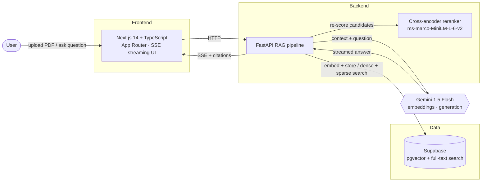
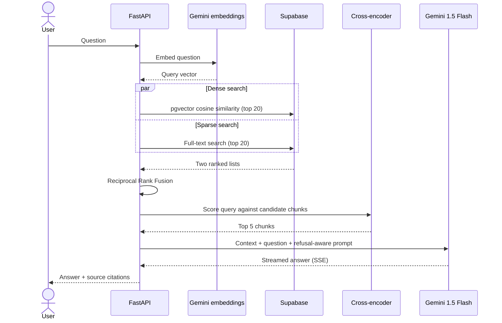

<div align="center">

# PolicyPulse

**Document question-answering with production-style RAG: hybrid retrieval, cross-encoder reranking, and cited, grounded answers.**

PolicyPulse is a full-stack Next.js and FastAPI application that answers questions about dense documents such as insurance policies, legal contracts, or any PDF. Upload a document, ask questions in plain English, and get streamed answers grounded strictly in the document's content, each attached to its source chunks.

[](https://nextjs.org/)
[](https://fastapi.tiangolo.com/)
[](https://supabase.com/)
[](https://ai.google.dev/)
[](https://docs.ragas.io/)

**[Watch the video demo →](https://youtu.be/Nt3XbODsZH8)** 

</div>


---

## Live demo

> **Note:** The backend runs on Render's free tier and spins down after inactivity. The first request can take about 30 seconds to wake it up.

**[Add your deployed URL here]**

---

## Why this exists

Most RAG demos stop at "embed and cosine search." PolicyPulse goes further and shows what it takes to make retrieval reliable enough to trust, and how to measure quantitatively whether it works.

---

## How it works

| Stage | What happens |
| --- | --- |
| **Ingestion** | PDF text is extracted page by page, chunked (512 characters, 50 overlap), embedded with Gemini, and stored in Supabase with both a vector column and a full-text search column |
| **Retrieval** | The question is embedded and run through two parallel searches: dense (pgvector cosine similarity) and sparse (Postgres full-text search, BM25-style ranking). Results are merged with Reciprocal Rank Fusion and re-scored by a cross-encoder before the top 5 chunks go to the LLM |
| **Generation** | Gemini 1.5 Flash answers strictly from the retrieved context, streamed token by token over SSE, and refuses explicitly when the answer isn't in the document |
| **Evaluation** | RAGAS scores (faithfulness, answer relevancy, context precision) run against a hand-written golden question set |

### Architecture



### Query pipeline



---

## Design decisions

### Why hybrid search, not just embeddings

Dense vector search handles semantic similarity well but misses exact matches. Clause numbers, dollar figures, and policy IDs often get buried because their embeddings don't sit near the question's embedding. Postgres full-text search catches these directly.

Reciprocal Rank Fusion merges the two result sets by rank position rather than raw score. Cosine similarity and `ts_rank` scores live on incompatible scales, so they can't be combined directly.

### Why reranking

The initial retrieval is fast but approximate and returns 20 candidate chunks. The cross-encoder (`ms-marco-MiniLM-L-6-v2`) scores the query jointly with each candidate's full text. It costs more per comparison but picks the best-matching passages far more accurately. Running it on a narrowed candidate set keeps latency reasonable.

### Why a refusal-aware system prompt

A RAG system that always answers, even when the retrieved context doesn't contain the answer, is the most common failure mode in portfolio projects. It quietly destroys faithfulness scores. PolicyPulse's system prompt tells the model to decline when context is insufficient, and this is one of the first behaviors tested against the live demo.

---

## Tech stack

| Layer | Choice | Why |
| --- | --- | --- |
| **Frontend** | Next.js 14 (App Router) + TypeScript | Server components for data fetching, streaming UI via SSE |
| **Backend** | FastAPI (Python) | Async-native, clean typing, fast to iterate |
| **Vector DB** | Supabase (pgvector) | Free tier, SQL-native, no separate vector database service |
| **Keyword search** | Postgres full-text search | Built into Supabase, no extra infrastructure |
| **Embeddings** | Gemini `text-embedding-004` | Free tier, 768 dimensions, strong MTEB performance |
| **Reranker** | `cross-encoder/ms-marco-MiniLM-L-6-v2` | Free, runs locally, well validated for passage reranking |
| **Generation** | Gemini 1.5 Flash | Free tier, fast, large context window |
| **Evaluation** | RAGAS | Standard library for RAG-specific quality metrics |

---

## API overview

| Endpoint | Method | Purpose |
| --- | --- | --- |
| `/health` | GET | Service health check |
| `/ingest` | POST | Upload a PDF, then chunk, embed, and store it |
| `/query` | POST | Ask a question; returns a streamed SSE answer with citations |
| `/documents` | GET | List ingested documents |
| `/documents/{id}` | GET | Get a single document's status |
| `/eval/scores` | GET | Retrieve RAGAS evaluation scores for a document |

---

## Local setup

### Backend

```bash
cd backend
python -m venv venv
source venv/bin/activate
pip install -r requirements.txt
```

Create `backend/.env`:

```bash
GOOGLE_API_KEY=your-gemini-key
SUPABASE_URL=https://your-project.supabase.co
SUPABASE_SERVICE_KEY=your-service-role-key
```

Run the database schema (`backend/sql/schema.sql`) in the Supabase SQL editor, then start the server:

```bash
uvicorn app.main:app --reload --port 8000
```

Open <http://localhost:8000/docs> for the interactive API explorer.

### Frontend

```bash
cd frontend
npm install
```

Create `frontend/.env.local`:

```bash
FASTAPI_URL=http://localhost:8000
```

```bash
npm run dev
```

Open <http://localhost:3000>.

---

## Scope

This is a portfolio project, not a production system. A few things were left out on purpose:

| Area | Decision |
| --- | --- |
| **Authentication** | None. The demo is intentionally open. Auth adds engineering surface area but doesn't demonstrate retrieval quality, which is the focus here |
| **Ingestion** | Synchronous and blocking. Fine at portfolio scale; a background worker is the natural next step for large documents |
| **Reranker on free tier** | Render's 512 MB memory limit may restrict the cross-encoder to local development and evaluation. The reported RAGAS scores reflect the full pipeline, including reranking |

## Roadmap

- [ ] Swap the `ivfflat` pgvector index for `hnsw` for better recall at scale
- [ ] Add query rewriting (HyDE or step-back prompting) for ambiguous questions
- [ ] Multi-document comparison (e.g., "how does this policy's deductible compare to that one?")
- [ ] Move ingestion to a background queue for large files
- [ ] Per-user authentication and row-level security in Supabase

---

## License

Add your license here, for example [MIT](LICENSE).
